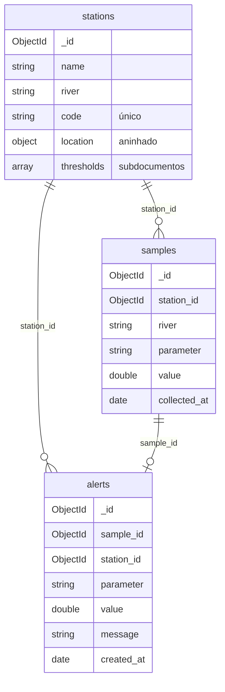

# Monitoramento de Qualidade da Água em Rios (ODS 6 & 14)

> **Atividade de Estudo Programada (AEP) — Engenharia de Software**  
> Prova de Conceito (PoC) interdisciplinar para monitoramento contínuo da qualidade da água em rios utilizando Go e Banco de Dados NoSQL (MongoDB).

---

## Alinhamento aos Objetivos de Desenvolvimento Sustentável (ONU)

- **ODS 6 — Água Potável e Saneamento:** Monitoramento de parâmetros críticos (pH, Turbidez, Oxigênio Dissolvido) para preservação de mananciais.
- **ODS 14 — Vida na Água:** Prevenção e controle da poluição hídrica para proteção dos ecossistemas aquáticos.

---

## Tecnologias Utilizadas

- **Linguagem:** Go (Golang 1.23+)
- **Banco de Dados:** MongoDB 7.0 (NoSQL)
- **Documentação Interativa:** Swagger / OpenAPI (Swaggo)
- **Conteinerização:** Docker & Docker Compose
- **Integração Contínua (CI):** GitHub Actions

---

## Como Executar o Projeto

### Pré-requisitos

- [Docker e Docker Compose](https://www.docker.com/) instalados
- Go 1.23+ para desenvolvimento local e testes. Instale o gerador do Swagger com `go install github.com/swaggo/swag/cmd/swag@v1.16.4` e deixe `swag` no PATH.

### 1. Configurar variáveis de ambiente

Copie o arquivo de exemplo para criar o `.env`:

```bash
cp .env.example .env
```

No PowerShell, use `Copy-Item .env.example .env`. As credenciais do exemplo são para execução local.

### 2. Executar a Aplicação

#### Opção A: Execução Completa via Docker (Recomendado para Avaliação)

Sobe o MongoDB e a API Go em containers conectados:

```bash
make docker-all
# ou: docker compose up -d --build --wait
```

#### Opção B: Desenvolvimento Local Rápido

Sobe apenas o banco no Docker e executa a API no terminal:

```bash
make docker-up   # Sobe o MongoDB
make run         # Regera a documentação e inicia a API
```

Sem Make, execute `docker compose up -d --wait mongodb` e `go run ./cmd/api`.
O MongoDB inicializa o replica set local `rs0`, necessário para salvar uma coleta e
sincronizar o alerta na mesma transação. O Compose usa o volume novo
`mongo_entrega2_data`. O volume `mongo_data` da primeira entrega fica separado.
Se usar um MongoDB externo via `MONGO_URI`, aponte para um replica set com acesso de escrita.

---

## Documentação da API (Swagger)

Com a aplicação rodando, acesse a documentação interativa no navegador:
**[http://localhost:8080/swagger/index.html](http://localhost:8080/swagger/index.html)**

---

## Estrutura do Banco

O banco `water_monitoring` tem três coleções. A estação é o centro do modelo:
cada coleta aponta para uma estação, e cada alerta aponta para a coleta que o
gerou e para a estação dela.



### `stations` — documento complexo

```json
{
  "_id": "ObjectId",
  "name": "Ponto Ponte do Rio Ivaí",
  "river": "Rio Ivaí",
  "code": "IVA-001",
  "location": { "city": "Maringá", "state": "PR", "lat": -23.42, "lng": -51.93 },
  "thresholds": [
    { "parameter": "pH", "min": 6.0, "max": 9.0 },
    { "parameter": "Turbidity", "max": 100 }
  ]
}
```

- `location` é um objeto aninhado e `thresholds` é uma lista de subdocumentos.
  Os dois **ficam dentro da estação** porque nascem, mudam e morrem com ela, só
  fazem sentido para aquela estação e são sempre lidos junto com ela. Com isso,
  uma única leitura (`FindOne`) traz tudo o que é preciso para avaliar uma coleta,
  e a lista de limiares de uma estação é pequena e limitada.
- `min` e `max` são opcionais: um limiar pode ter só um dos lados. Um limite
  ausente não é gravado; um limite `0` é gravado e vale como limite.
- `code` tem **índice único** (`code_unique`), criado na inicialização da API.
  Código repetido responde HTTP 409.
- Validações: nome, rio, código, cidade e UF obrigatórios; todo limiar precisa
  de parâmetro; `min ≤ max` quando os dois existem; limiar de pH entre 0 e 14.

### `samples` — referência à estação

```json
{
  "_id": "ObjectId",
  "station_id": "ObjectId da estação",
  "river": "Rio Ivaí",
  "parameter": "pH",
  "value": 7.2,
  "collected_at": "2026-10-27T14:00:00Z"
}
```

- A coleta **referencia** a estação por `station_id` em vez de ficar dentro dela,
  porque as coletas crescem sem limite ao longo do tempo. Aninhadas, elas fariam
  o documento da estação crescer até o limite de 16 MB do MongoDB e obrigariam a
  carregar todo o histórico a cada leitura da estação. Separadas, podem ser
  filtradas (`GET /samples?station_id=`), editadas e removidas individualmente.
- A API só aceita `station_id` de uma estação existente.
- Para gravar uma coleta, crie a estação primeiro com `POST /stations` e copie seu `id`.
  Envie `{"station_id":"<id da estação>","parameter":"pH","value":7.2}` no
  `POST /samples` ou no `PUT /samples/{id}`. O valor `0` é válido e a
  ausência de `collected_at` usa a hora da operação. ID inválido retorna 400 e
  estação inexistente retorna 404.
- `river` é copiado da estação no momento da gravação, para que a coleta continue
  legível sozinha.
- Coletas antigas importadas sem estação aparecem na listagem geral. Para editá-las,
  informe a estação. O filtro por estação retorna apenas coletas já vinculadas.
- Uma estação só pode ser excluída quando não há coletas dela (HTTP 409 caso
  contrário), para que nenhuma coleta fique apontando para uma estação inexistente.

### `alerts` — relacionamento materializado

```json
{
  "_id": "ObjectId",
  "sample_id": "ObjectId",
  "station_id": "ObjectId",
  "parameter": "pH",
  "value": 4.2,
  "message": "pH abaixo do mínimo 6.0 da estação IVA-001",
  "created_at": "2026-10-27T14:00:00Z"
}
```

- Não existe `POST /alerts`: o alerta é criado pela API quando uma coleta fica
  fora de um limiar da estação. A coleta **é gravada mesmo assim**, porque o
  registro da poluição importa.
- A regra fica em `Station.Evaluate(parameter, value)`: compara o parâmetro sem
  diferenciar maiúsculas e minúsculas, trata os limites como inclusivos e, sem
  limiar para aquele parâmetro, não gera alerta.
- O alerta guarda `sample_id` e `station_id` como referências, mas também copia
  `parameter`, `value` e `message`. Assim, listar e filtrar alertas
  (`GET /alerts?station_id=`) não exige consultar as outras coleções, e o alerta
  continua mostrando o que foi violado mesmo que os limiares da estação mudem depois.
- Há no máximo um alerta por coleta. Ao editar a coleta, a API reavalia o limiar:
  cria o alerta se houver uma nova violação, atualiza o alerta existente preservando
  sua data ou remove o alerta se a coleta entrar no limiar. Excluir a coleta também
  remove seu alerta. Coleta e alerta são gravados ou revertidos juntos.
- A API aceita requisições do Vite em `http://localhost:5173`, com base padrão
  `http://localhost:8080` para o frontend.

---

## Testes Automatizados e Cobertura

Os testes usam `testing` e Testify. Service e Controller usam um repositório
simulado; os testes de integração do Repository usam MongoDB real.
A API não precisa estar rodando para executar a suíte.

### Preparar o MongoDB exclusivo de testes

Com Docker Desktop iniciado, execute na raiz do projeto:

```powershell
docker compose -f docker-compose.test.yml up -d --wait
$env:MONGO_TEST_URI = "mongodb://127.0.0.1:27018/?replicaSet=rs0&directConnection=true"
```

No Bash, use `export MONGO_TEST_URI="mongodb://127.0.0.1:27018/?replicaSet=rs0&directConnection=true"`.
A variável deve ser definida em cada novo terminal. A suíte não carrega o `.env`
da aplicação nem utiliza `MONGO_INITDB_DATABASE`. O container usa a porta 27018
e armazenamento temporário, sem compartilhar o volume do banco da aplicação.
Cada teste de integração cria um banco `aep_test_<id>` e remove somente esse banco
ao finalizar. Uma execução interrompida pode deixar bancos nesse container;
eles desaparecem quando o container for removido.

### Executar a suíte completa e gerar cobertura

```powershell
go test -v "-coverprofile=coverage.out" ./...
go tool cover "-func=coverage.out"
go tool cover "-html=coverage.out" -o coverage.html
```

As aspas preservam os argumentos no PowerShell; no Bash, os comandos obrigatórios
também funcionam sem aspas (`go test -v -coverprofile=coverage.out ./...`,
`go tool cover -func=coverage.out` e `go tool cover -html=coverage.out -o coverage.html`).
Confira se o primeiro comando terminou com sucesso antes de usar os relatórios.
O valor relevante é a linha `total:` de `go tool cover -func`, considerando todos
os pacotes do comando `./...`, sem filtrar arquivos da cobertura.

Atalhos equivalentes:

```bash
make test
```

Para gerar o relatório visual interativo em HTML:

```bash
make test-html
# Abra o arquivo coverage.html no navegador
```

Para abrir no Windows: `Start-Process .\coverage.html`.
Para executar apenas os testes que não exigem MongoDB: `make test-unit`
ou `go test -short -v ./...`. Esse modo exibe os testes de integração como
`SKIP` e **não é a execução usada como evidência da cobertura mínima**.
Na suíte completa, `MONGO_TEST_URI` ausente ou MongoDB indisponível causa falha.

Para remover somente o container de testes:

```powershell
docker compose -f docker-compose.test.yml down
```

### O que é validado

- Service: estação existente, parâmetro obrigatório, pH de 0 a 14, datas, operações válidas e propagação de erros.
- Controller: respostas JSON, códigos HTTP, dados inválidos e falhas simuladas do banco.
- Repository: Create, FindAll, FindByID, FindByRiver, Update e Delete no MongoDB; ID duplicado, documentos inválidos e cancelamento.
- Estações: validações do documento aninhado (campos obrigatórios, `min ≤ max`,
  limiar de pH entre 0 e 14), regra de limiar (`Evaluate`), exclusão bloqueada
  quando há coletas (409), código duplicado (409) e CRUD com índice único no MongoDB.
- Alertas: filtro por estação, unicidade por coleta, reavaliação e exclusão. O teste HTTP
  de integração também verifica rollback quando o MongoDB rejeita a gravação de um
  alerta e cobre a disputa entre cadastrar uma coleta e excluir sua estação.
- CORS: preflight do Vite e ausência de permissão para outras origens.
- Database: montagem da URI, configuração isolada e conexão com o banco de testes.
- Inicialização: `cmd/api/main_test.go` inicia o servidor no processo de teste desse
  pacote, em porta dinâmica, e verifica as rotas reais e o Swagger. O servidor
  termina quando esse processo de teste encerra; não usa a porta 8080 nem o banco da aplicação.

### GitHub Actions

A pipeline usa a versão de Go definida em `go.mod`, inicia o replica set descartável
do Compose de testes e executa a suíte completa. Credenciais de produção e secrets não
são necessários para esse banco de testes. A execução falha se a cobertura total
for menor que 70%. Os arquivos `coverage.out` e `coverage.html` ficam disponíveis
no artefato `coverage-report` da execução. Os atalhos locais mostram a cobertura;
a verificação automática do limite ocorre no CI.

O roteiro para a gravação está em [docs/roteiro-video.md](docs/roteiro-video.md).
