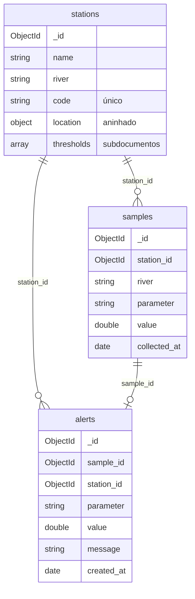

# Banco

O banco `water_monitoring` tem três coleções. A estação é o centro do modelo: cada coleta aponta para uma estação, e cada alerta aponta para a coleta que o gerou e para a estação dela.



O Compose da aplicação usa o volume `mongo_entrega2_data`. O volume `mongo_data` da primeira entrega fica separado. Se o MongoDB for externo, via `MONGO_URI`, ele precisa ser um replica set com acesso de escrita. O replica set local se chama `rs0`.

## `stations`

```json
{
  "_id": "ObjectId",
  "name": "Ponto Ponte do Rio Ivaí",
  "river": "Rio Ivaí",
  "code": "IVA-001",
  "location": { "city": "Maringá", "state": "PR", "lat": -23.42, "lng": -51.93 },
  "thresholds": [
    { "parameter": "pH", "min": 6.0, "max": 9.0 },
    { "parameter": "Turbidity", "max": 100 }
  ]
}
```

`location` é um objeto aninhado e `thresholds` é uma lista de subdocumentos. Os dois ficam dentro da estação porque nascem, mudam e morrem com ela, só fazem sentido para aquela estação e são sempre lidos junto com ela. Uma única leitura (`FindOne`) traz o que a API precisa para avaliar uma coleta, e a lista de limiares de uma estação é pequena.

`min` e `max` são opcionais: um limiar pode ter só um dos lados. Um limite ausente não é gravado. Um limite `0` é gravado e vale como limite.

`code` tem índice único (`code_unique`), criado na inicialização da API. Código repetido responde HTTP 409.

Validações: nome, rio, código, cidade e UF obrigatórios. Todo limiar precisa de parâmetro. `min ≤ max` quando os dois existem. Limiar de pH fica entre 0 e 14.

Uma estação só pode ser excluída quando não há coletas dela. Se houver, a API responde 409, para nenhuma coleta apontar para uma estação inexistente.

## `samples`

```json
{
  "_id": "ObjectId",
  "station_id": "ObjectId da estação",
  "river": "Rio Ivaí",
  "parameter": "pH",
  "value": 7.2,
  "collected_at": "2026-10-27T14:00:00Z"
}
```

A coleta referencia a estação por `station_id` em vez de ficar dentro dela, porque as coletas crescem sem limite. Aninhadas, elas fariam o documento da estação crescer até o limite de 16 MB do MongoDB e obrigariam a carregar todo o histórico a cada leitura da estação. Separadas, podem ser filtradas (`GET /samples?station_id=`), editadas e removidas individualmente.

A API só aceita `station_id` de uma estação existente. ID inválido retorna 400. Estação inexistente retorna 404.

Para gravar uma coleta, crie a estação com `POST /stations` e use o `id` dela. O corpo é `{"station_id":"<id da estação>","parameter":"pH","value":7.2}` no `POST /samples` ou no `PUT /samples/{id}`. O valor `0` é válido. Sem `collected_at`, a API usa a hora da operação.

`river` é copiado da estação no momento da gravação, para a coleta continuar legível sozinha.

Coletas antigas importadas sem estação aparecem na listagem geral. Para editá-las, informe a estação. O filtro por estação retorna apenas coletas já vinculadas.

## `alerts`

```json
{
  "_id": "ObjectId",
  "sample_id": "ObjectId",
  "station_id": "ObjectId",
  "parameter": "pH",
  "value": 4.2,
  "message": "pH abaixo do mínimo 6.0 da estação IVA-001",
  "created_at": "2026-10-27T14:00:00Z"
}
```

Não existe `POST /alerts`. O alerta é criado pela API quando uma coleta fica fora de um limiar da estação. A coleta é gravada mesmo assim, porque o registro da medição importa.

A regra fica em `Station.Evaluate(parameter, value)`: compara o parâmetro sem diferenciar maiúsculas e minúsculas, trata os limites como inclusivos e, sem limiar para aquele parâmetro, não gera alerta.

O alerta guarda `sample_id` e `station_id` como referências, e também copia `parameter`, `value` e `message`. Listar e filtrar (`GET /alerts?station_id=`) não consulta as outras coleções, e o alerta continua mostrando o que foi violado mesmo que os limiares da estação mudem depois.

Há no máximo um alerta por coleta. Ao editar a coleta, a API reavalia o limiar: cria o alerta se houver uma nova violação, atualiza o alerta existente preservando a data, ou remove o alerta se a coleta entrar no limiar. Excluir a coleta também remove o alerta dela. Coleta e alerta são gravados ou revertidos juntos, na mesma transação do replica set.
